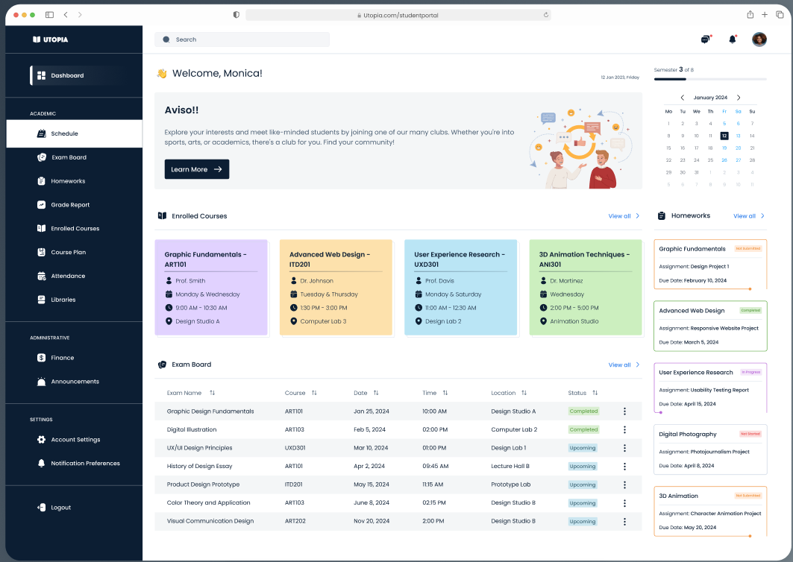

## 🎨 Template Figma

> **Referência visual e de experiência do usuário (UI/UX)**

‣ O template desenvolvido no **Figma** será utilizado como referência para definir a identidade visual, a organização das telas e a experiência de navegação do sistema.

‣ A proposta é manter um visual **claro, moderno e intuitivo**, facilitando a compreensão das informações e permitindo que o usuário encontre rapidamente as funcionalidades que precisa.

‣ **Importância no projeto:** o Figma permite validar a estrutura e a experiência do sistema antes da implementação, reduzindo alterações desnecessárias durante o desenvolvimento.

Link:  https://www.figma.com/design/VJsePwJ1epLh7DkUIKxVvm/Student-Portal--Community-?node-id=7-860&p=f&t=lv3Uc97CXyn1TOob-0 

### 🖼️ Referência visual

### Template Xano

‣Referência para estrutura de dados, API e backend

‣ O template no **Xano** servirá como referência para estruturar o backend do sistema, organizando os dados, endpoints e regras necessárias para conectar a aplicação ao banco de dados e ao frontend.

‣ A utilização de um template ajuda a estabelecer uma estrutura inicial organizada, que poderá ser adaptada conforme as necessidades do projeto.

### Referência estrutural

[Template Figma](./images/template-figma.png)
